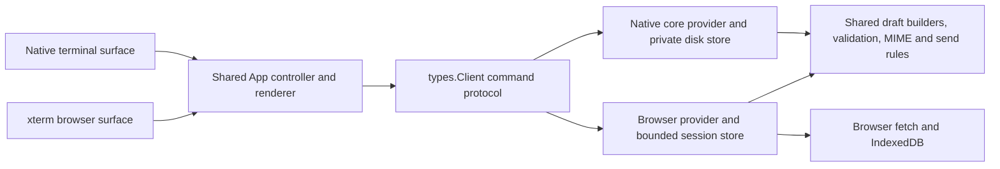

# Browser platform adapter

The browser and native terminal run the same `App` controller in
`src/terminal/tui.zig`. Input, mail navigation, search, contacts, recipient
completion, composing, draft review and send receipts use that controller.
The browser shell initializes a terminal surface and drains the same completed
jobs through `App.finish`; it has no separate workflow state machine.



`src/terminal/platform.zig` supplies job launch/completion, event delivery,
operation identity and platform capabilities. Native jobs retain concurrent
futures and the original blocking versus nonblocking event behavior. Browser
jobs run through WebAssembly Promise Integration; the host serializes one
operation, and completion is applied after the worker returns. The native
controller's account, selection and draft generation checks remain in use.
Native account switches retain their background refresh. The browser platform
selects cached accounts locally, including missing bodies and failed/empty
cache states. Explicit connection initializes an uncached actor once; Ctrl+R,
Enter and Gmail search retain their network routes.

`src/browser_provider.zig` implements the native `types.Client` JSON protocol.
It owns verified browser sessions, current mail inventory, bounded folder/search
views, read-only contacts, session drafts and send receipts. It never receives
keyboard events. `src/browser_live.zig` supplies the bounded HTTPS transport to
the ordinary Gmail/People decoders. Tokens remain in the JavaScript host.

Both providers use `conversation_draft.zig`, `draft_codec.zig`,
`send_outcome.zig` and `client_contract.zig`. These modules define reply/forward
construction, draft validation, content identity, conservative uncertain-send
classification and the strictly read-only cache command contract. Storage and
transport remain separate because native files and browser storage have
different lifetimes and capabilities.

## Extending a workflow

Add UI behavior to `App` once. Add provider commands through `types.Client` when
the behavior needs account data or storage. Put portable mail rules in shared
domain modules. Platform-specific services belong at the platform or provider
boundary; expose capabilities and use the existing common help/action filtering
when a platform cannot support an action yet.

Native capability defaults preserve existing behavior. Browser capabilities
currently support reading, cache search, contacts and completion, session
drafts, plain/Markdown compose, text-quoted reply/forward and reviewed sending.
Native filesystem attachments, external editors, original-message resource
capture, aliases, contact mutations, desktop preferences and background send
queues remain unavailable in the browser. Text forwarding explicitly reports
omitted source attachments through the draft and send review.

Normal native builds do not need browser dependencies. `-Dbrowser=true` builds
the WASM module and packages pinned browser assets into the native executable;
that executable can run `omagma server` without Node.js or a separate asset
folder. The browser-only compiler and acceptance targets are opt-in so ordinary
native feature development keeps its current build loop.

## Bounds and verification

Browser storage keeps at most three verified actors, 300 current mail records
per actor, 30 visible rows per page, 100 contacts, eight session drafts per actor
under an aggregate 8 MiB draft quota, and 64 send records. Persisted mail has a
3 MiB snapshot and 8 MiB aggregate limit. Cache restores require a fresh profile
verification and exact account/client/grant binding. Cache contains no tokens,
drafts, native handles or provider metadata. Browser date filters use UTC.

An uncertain send is recorded before provider dispatch. The host fence remains
unconfirmed until the shared controller acknowledges consumption of the exact
receipt. Any provider, envelope or UI allocation failure retains uncertainty;
only consumed successful sends retire their drafts and free active draft slots.
Native clients can omit this callback because their durable receipt log remains
available for reconciliation. Editing, discarding or
resubmitting its protected draft is refused until explicit acknowledgement;
mail browsing and checking Sent remain available. The pending host marker
survives reload, while session drafts do not. Acknowledgement retains the
uncertain receipt and requires a fresh review before a new submission.

Run the appropriate native and browser checks under the cooperative host lock:

```sh
zig build test -Doptimize=debug -Dtest-filter="local UI:"
zig build test-browser-provider test-browser-cache -Doptimize=debug
npm test --prefix web-demo
node tests/browser_wasm.mjs --site-dir /absolute/path/to/site
node tests/browser_wasm_live.mjs --site-dir /absolute/path/to/site
```

Provider tests use independent synthetic responses and allocator faults.
Browser acceptance uses an owned headless profile and intercepts Google URLs;
it makes no production mailbox writes. Native PTY acceptance checks the same
workflows without capturing the user's desktop or keyboard. Review adapter
boundaries and both platforms before integrating changes into main.

Browser persisted inventory is a cached snapshot, not proof of current query
membership. Runtime complete query views are bounded and not persisted. Fresh
profile verification and mailbox refresh establish the current live view;
cached query results may be stale until that refresh. Complete unfiltered
folder responses reconcile their known label membership in the saved inventory.
Live provider queries currently return a 30-message head; use a narrower Gmail
query for older mail. Cached pagination stays within the retained inventory.
