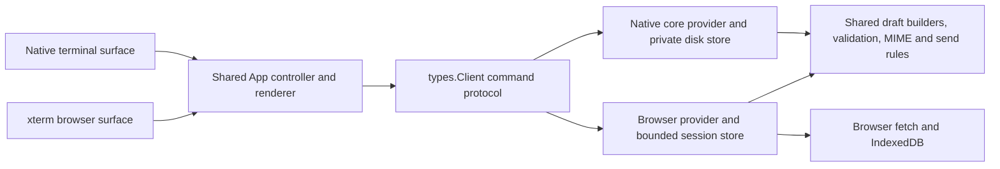

# Browser platform adapter

The browser and native terminal run the same `App` controller in
`src/terminal/tui.zig`. Input, mail navigation, search, contacts, recipient
completion, composing, draft review and send receipts use that controller.
The browser shell initializes a terminal surface and drains the same completed
jobs through `App.finish`; it has no separate workflow state machine.



`src/terminal/platform.zig` supplies job launch/completion, event delivery,
operation identity and platform capabilities. Native jobs retain concurrent
futures and the original blocking versus nonblocking event behavior. Browser
jobs run through WebAssembly Promise Integration; the host serializes one
operation, and completion is applied after the worker returns. The native
controller's account, selection and draft generation checks remain in use.
Native account switches retain their background refresh. The browser platform
selects cached accounts locally, including missing bodies and failed/empty
cache states. Explicit connection initializes an uncached actor once; Ctrl+R,
Enter and Gmail search retain their network routes.

`src/browser_provider.zig` implements the native `types.Client` JSON protocol.
It owns verified browser sessions, current mail inventory, bounded folder/search
views, read-only contacts, session drafts and send receipts. It never receives
keyboard events. `src/browser_live.zig` supplies the bounded HTTPS transport to
the ordinary Gmail/People decoders. Tokens remain in the JavaScript host.

Both providers use `conversation_draft.zig`, `conversation_source.zig`,
`draft_codec.zig`, `draft_summary.zig`, `send_outcome.zig` and `client_contract.zig`.
These modules define reply/forward
construction, draft validation, content identity, conservative uncertain-send
classification and the strictly read-only cache command contract. Storage and
transport remain separate because native files and browser storage have
different lifetimes and capabilities.

Draft lists carry compact shared summaries; explicit draft reads carry full
content. The controller sends edited fields without retransmitting the immutable
stored original and requests an ID-only save acknowledgement. Both adapters
retain full responses by default for existing API clients.

## Extending a workflow

Add UI behavior to `App` once. Add provider commands through `types.Client` when
the behavior needs account data or storage. Put portable mail rules in shared
domain modules. Platform-specific services belong at the platform or provider
boundary; expose capabilities and use the existing common help/action filtering
when a platform cannot support an action yet.

Native capability defaults preserve existing behavior. Browser capabilities
support reading, cache search, contacts and completion, session drafts,
plain/Markdown compose, text-quoted or formatted reply/reply-all/forward,
original `.eml` forwarding, source attachment retention and reviewed sending.
Replies exclude the account's verified aliases. Source capture uses fresh FULL
metadata, the shared original-resource plan and an injected attachment source;
cached reader snapshots never stand in for a complete formatted source.
Native filesystem dialogs, external editors, sender-alias selection, contact
mutations, desktop preferences and background send queues remain unavailable.

Browser source files use the existing portable inline tier: at most 2 MiB of
decoded attachment data in a draft, a bounded 3 MiB JSON envelope, and the
aggregate session draft quota. The exact MIME/base64 envelope can impose a
smaller send limit. Oversized captures and sends fail explicitly without
dropping files. For over-quota sources the shared chooser explicitly offers
Text quote with omitted files, and the omission remains visible through review.
Native blob-backed files retain their separate 25 MiB decoded /
35 MiB MIME spool tier. A future browser blob/upload adapter can supply the
shared byte-source encoder without changing the workflow controller.

Normal native builds do not need browser dependencies. `-Dbrowser=true` builds
the WASM module and packages pinned browser assets into the native executable;
that executable can run `omagma server` without Node.js or a separate asset
folder. The browser-only compiler and acceptance targets are opt-in so ordinary
native feature development keeps its current build loop.

## Bounds and verification

Browser storage keeps at most three verified actors, 300 current mail records
per actor, 30 visible rows per page, 100 contacts, eight session drafts per actor
under an aggregate 8 MiB draft quota, and 64 send records. Persisted mail has a
3 MiB snapshot and 8 MiB aggregate limit. Cache restores require a fresh profile
verification and exact account/client/grant binding. Cache contains no tokens,
drafts, native handles or provider metadata. Browser date filters use UTC.

The browser uses a 64 MiB coalescing heap and a separate 16 MiB message-decoding
workspace within a fixed 96 MiB WASM memory. Static buffers, tables and the
2 MiB stack occupy the remainder. WASM memory cannot grow. Temporary response
and validation arenas reuse these reservations and release their buffers before
retaining normalized results or serializing drafts. Browser JavaScript, DOM,
IndexedDB and browser networking have their own host-managed allocations.

Native entrypoints also reserve their application and IO pools at startup;
both front ends use the same message-decoding workspace and metadata policy.
WASM exports that policy so JavaScript cache admission uses the compiled
limits. Subjects allow 16 KiB plus reply/forward prefixes, display names 1 KiB,
received addresses 1 KiB, submitted addresses 512 bytes, filenames 512 bytes,
and aggregate headers 128 KiB. Sizes count UTF-8 bytes. Outgoing envelopes still
allow at most 32 recipients. Portable SMTP address lengths produce a review
warning rather than rejecting received mail or bounded Gmail submission.

Message-local failures retain identifiable warning rows and readable neighbors.
Unsupported text alternatives can retain a supported sibling; an unavailable
body stays an explicit placeholder. Metadata batches and conversation results
each retain up to 4 MiB of full message DTOs, with bounded placeholders for remaining members; an omitted
body can be read individually. Cache admission failure does not hide a decoded
body. `status:partial` searches warnings locally. Unknown labels do not authorize
membership reconciliation. Authentication, cancellation, identity mismatches
and exhaustion of the retained application pool remain operation failures.

The browser displays the newest 30 members from the shared provider's bounded
100-member thread enumeration and reports omitted members. It chooses that
window before individual body fetches. Both adapters spend the full-body budget
on newest members first, then return chronological results. Cached metadata-only
members stay visible; focus their card and press Enter to read the body. Replies
and text/formatted forwards refuse unavailable bodies rather than using compact
metadata or silently empty quotes. Original `.eml` forwarding remains a separate
opaque-byte path with a 2 MiB original limit.

Decoder revisions accompany saved snapshots. A known refusal fixed by a newer
decoder becomes eligible for one later read without fetching during restore;
current refusals stay final. Legacy display headers normalize locally without
changing addresses, threading headers, body bytes or native cached files.

These allowances do not provide full IDNA normalization, every historical
charset, automatic selection among multiple From authors, or unbounded bodies,
conversations and reference chains. Browser contact editing, general filesystem
workflows and durable browser drafts retain the existing platform restrictions.
Archive/label/contact writes, RSVP, URL opening, clipboard integration, external
editors and disk draft recovery remain native platform capabilities. Browser
dates use UTC. Scoped view IDs live in the tab's bounded ledger; after reload,
rows with unverified labels can be found through All Mail and `status:partial`.

The new allowances are still quotas: 256 threading references cannot accept a
257th parent reference, and a subject already filling prefix headroom can refuse
an additional prefix. There is no reference-chain compaction, full Unicode
normalization/case-folded search, universal charset support, or acceptance of
arbitrarily large filename/participant/body combinations. A malformed or
oversized contact remains subject to strict People normalization; mail-row
isolation does not change contact-write validation.

The shared Gmail preparation phase renders and freezes the exact MIME and host
JSON payload before an uncertain send is recorded. Local preparation failures
return a rejected receipt without starting a provider request. If even that
local rejection cannot be allocated, a proven-before-submission signal keeps
the shared composer editable without allocating a receipt. The host fence remains
unconfirmed until the shared controller acknowledges consumption of the exact
receipt. Any provider, envelope or UI allocation failure after submission retains uncertainty;
only consumed successful sends retire their drafts and free active draft slots.
Quota admission can reclaim these confirmed retired draft bytes across accounts;
active drafts, uncertain sends and receipts awaiting consumption stay protected.
Native clients can omit this callback because their durable receipt log remains
available for reconciliation. Editing, discarding or
resubmitting its protected draft is refused until explicit acknowledgement;
mail browsing and checking Sent remain available. The pending host marker
survives reload, while session drafts do not. Acknowledgement retains the
uncertain receipt and requires a fresh review before a new submission.

Run the appropriate native and browser checks under the cooperative host lock:

```sh
zig build test -Doptimize=debug -Dtest-filter="local UI:"
zig build test-browser-provider test-browser-cache -Doptimize=debug
npm test --prefix web-demo
node tests/browser_wasm.mjs --site-dir /absolute/path/to/site
node tests/browser_wasm_live.mjs --site-dir /absolute/path/to/site
```

Provider tests use independent synthetic responses and allocator faults.
Browser acceptance uses an owned headless profile and intercepts Google URLs;
it makes no production mailbox writes. Native PTY acceptance checks the same
workflows without capturing the user's desktop or keyboard. Review adapter
boundaries and both platforms before integrating changes into main.

Browser persisted inventory is a cached snapshot, not proof of current query
membership. Runtime complete query views are bounded and not persisted. Fresh
profile verification and mailbox refresh establish the current live view;
cached query results may be stale until that refresh. Complete unfiltered
folder responses reconcile their known label membership in the saved inventory.
Live provider queries currently return a 30-message head; use a narrower Gmail
query for older mail. Cached pagination stays within the retained inventory.
